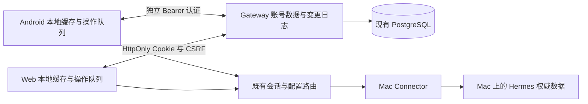

# HG-216 · Android / Web 账号数据同步方案

日期：2026-10-14。现状核对基线：`e473bec3`（当时的 `origin/main`）。

**状态：运行时尚未实现。** 初版按用户选择只梳理并提交完整方案文档。
后续分期与三项产品行为的批准见下方更新；未标注已定的同步默认值、迁移选择和接口仍是草案。
不以本文覆盖现行设计契约，不更改生产能力开关，不升版、不发布客户端或服务。
现状来自仓库源码；没有读取生产数据库、个人账号内容或设备私有存储，不能据此声称线上已启用某能力。

2026-10-15 更新：用户已批准实施分期，并确定 §11 所标注的三项产品行为。
[P0 可执行契约与验证记录](ACCOUNT_DATA_SYNC_P0.md) 已补充；完整已读的权威版本来源仍未通过门禁。
已批准的后续 P1a accountProfile 实现与明确未交付部分见 [P1a 运行契约](ACCOUNT_DATA_SYNC_P1A.md)。
该可选能力默认关闭，不表示本总方案的全部数据类别已实现或发布。
其余未标注决策继续是提案。P0没有接入运行时同步能力。

## 1. 结论与范围

同账号跨 Android 手机、浏览器和 Web 主屏应用，缺少一致的个人偏好与阅读状态。
建议在现有 Gateway 账号控制面增加**持久化账号数据**和同步协议，本地存储保留为缓存与离线操作队列。
这不是再加一层临时缓存：重装、换手机、换浏览器之后，应能从账号恢复用户明确保存的数据。

“服务端根本没有账号级数据”与源码不符。已有账号、安装实例、设备绑定、共享关系、默认 Mac、
生命周期事件/回执及 Web 名称/头像。缺口是这些能力没有组成 Android/Web 共用的个人数据层，
并且部分资料概念和本地存储作用域不一致。

推荐首先统一账号资料，再同步置顶、已读、模型收藏/推理偏好和常用提示词。
不把 Mac 会话正文、Hermes 配置、密钥、通知投递游标或附件缓存搬进个人偏好层。
草稿等用户内容单独评估并显式开启，避免一端编辑覆盖另一端还没发出的文字。

范围包含 Android、`web/` Web App 和 Gateway，必要时指出 Connector 的只读观察依赖。
`website/` 官网没有这类客户端数据；Desktop 只需交代账号显示的兼容关系，本文不扩展其产品界面。

## 2. 概念、权威来源与键

| 层次 | 身份与权威来源 | 同步规则 |
| --- | --- | --- |
| Hermes GO 账号 | Gateway 内部 `account_id` | 个人数据的所有者；服务端从认证主体取得，不能信任请求正文里的账号 ID |
| 客户端安装实例 | 手机/浏览器的 installation 与独立会话 | 授权、撤销、推送、投递回执仍各自独立；不能把“两个手机”误当“两台 Mac” |
| Mac | 公开 opaque `deviceId`；Connector 绑定/凭据代际另外管理 | 所有 Mac 相关个人数据都必须带此键；名称、邮箱、文件路径不能充当设备关联键 |
| Hermes profile | 某一台 Mac 上的 profile 标识，现有接口主要使用名称 | 默认身份按接口规则归一化；非默认名称保持原值，不按大小写或相似名称猜同一身份 |
| 持久会话 | `(deviceId, profileKey, storedSessionId)` | 不使用会过期的 runtime/live session handle；不同 Mac 的同名 profile、相同 session ID 互不影响 |
| 模型 | 结构化 `(provider, model)` | 收藏是个人偏好；模型可用性、默认模型和当前会话模型仍由目标 Mac/profile 决定 |
| 应用环境 | Gateway origin + account_id | 本地缓存、待同步队列、游标同样带环境，测试/生产和同名账号不混用 |

账号资料与 Hermes 身份装饰是两份实体：账号名称/头像用于登录账号；某个 profile 的显示别名、
头像、颜色和样式用于用户对该 Mac/profile 的个性化显示，不能重命名上游 profile。
推荐两份都可同步，但分别设键，默认不把 Android 的 `default` 身份覆盖到 Web 账号卡。

profile 尚无可依赖的跨重命名稳定 ID。重命名后的迁移必须由权威明确映射或用户选择；同名重建不能自动继承旧装饰。
绑定轮换若保留 `deviceId`，个人数据保留；新设备 ID 或解绑重建不能靠显示名称继承旧数据。
恢复 Mac 数据库、会话重建等情况需增加会话 incarnation/epoch，防止旧阅读标记套到新内容。

## 3. 现状清单与同步建议

表中 A 为 Android 应用存储，W 为浏览器存储；“本地”不等于已经隔离到 account_id。
依据编号对应 §4 的可点击源码。推荐列是未来设计，现状列才是当前行为。

| 数据 | Android 现状 | Web / Gateway 现状 | 推荐范围与收益 | 优先级 / 依据 |
| --- | --- | --- | --- | --- |
| 登录账号名称、头像 | 账号会话显示登录身份数据，与 profile 装饰分离 | Web 通过 `account_profiles` 持久化名称及头像字节；原生接口仍读身份资料 | 复用云端账号资料，原生/Web 共用解析与修订版本；换端保持一致 | P1 / E1 |
| Hermes profile 的别名、头像、颜色、样式 | `profile_identity` 按 profile 名，照片在 `files/avatars/`，未含账号/Mac 键 | Web 账号头像不是此实体；没有等价 profile 装饰编辑层 | `(账号, Mac, profile)` 的私人装饰，不改 Mac profile、不与其他账号共享 | P1 / E2 |
| 会话置顶 | `pinned_sessions`，token 含 Mac/profile/session，未含账号 | `hermes-go.pins.<Mac>`，登出清空 | `(账号, Mac, profile, session)`；任一端明确置顶/取消后其余端一致 | P1 / E3 |
| 会话已读/未读 | `session_read_state` 的 unread/known 集合，Mac/profile/session token；本地增删 | 页面 inbox 的 unseen 在内存；推送 worker 的 unread 在本浏览器 IndexedDB | 账号会话阅读进度；迟到的新活动仍未读，后台收件不等于阅读 | P1 / E4 |
| 生命周期终态、等待状态 | `SessionPhaseStore` 保存本地快照；运行态由实时流/恢复查询判断 | 页面 inbox 与实时流派生；事件持久化在 Gateway | 继续从运行/事件权威派生；云同步的是已读进度，不是客户端推测的 working/completed | 不新增偏好实体 / E4、E5 |
| 模型收藏 | `model_favorites`，应用全局、非 profile；键为 provider + NUL + model | localPrefs 的 models 按 Mac；键为 `provider/model` | 账号级结构化模型键，目标 Mac 不可用时保留收藏但不自动切换 | P1 / E6 |
| 每模型推理强度记忆 | `reasoning_presets`，全局 per-model | models 的 presets 按 Mac | 账号级偏好，应用前按目标 Mac/profile 能力验证；不复制会话执行状态 | P1 / E6 |
| 最近使用模型 | `model_recents`，全局最近 5 项 | models 的 recents 按 Mac，最近 5 项 | 账号级最近使用候选，合并真实使用操作后取最近 5 项；低于收藏优先级 | P2 / E6 |
| “筛选过的模型”、提供商展开 | Android selector 无搜索参数，展开集合为 UI 状态 | Web open 集合为组件状态，部分列表按可用性/收藏过滤 | 未发现独立持久化的“筛选模型名单”；先确认用户指隐藏名单还是展开状态，再设计，不凭描述造迁移源 | 待定义 / E6 |
| 模型目录、可用性 | ModelCatalogStore 是按 profile 的进程内缓存 | 目标 Mac 接口读取，页面缓存 | 保持 Mac/profile 权威，不把目录当账号收藏；未来缓存另补环境/Mac隔离 | 不同步缓存 / E6 |
| 默认模型、当前会话模型/推理设置 | Config/ModelRepository 经上游路由读写 | default-model 路由、session-model-config 等既有能力 | 保持 `(Mac, profile)` 默认值与会话执行值；不能用收藏同步隐式改另一台 Mac 的执行配置 | 既有路由 / E7 |
| 常用提示词 | `saved_prompts`，本机全局的 id/title/body | `hermes-go.prompts`，浏览器全局，登出清空 | 账号级提示词库；逐条版本、删除、编辑冲突；可能含私人内容，需说明上传范围 | P1 / E8 |
| 未发送的输入草稿 | `session_drafts`，owner + Mac/profile/session，文本持久化有数量/大小限制 | localStorage；scope 含 origin/account/Mac/profile/session，legacy 记录打开时归属一次 | 可选跨端文本草稿；并发版本保留，不自动发送；新会话草稿需独立 draftId，不能一律用 new | P3 / E9 |
| 发送被拒的未发送消息 | `session_unsent`，文本/错误码及本机附件缓存路径；不是普通草稿 | 重试载荷/附件在页面运行态，没有等价持久拒发消息库 | 留本机；同步最多作为以后独立“未发送内容恢复”，不得同步后自动重试 | 保持本地 / E9 |
| 尚未发送的图片/文件 | Draft 附件在应用 runtime；拒发附件有本地缓存 | Blobs、object URLs 在页面内存 | 保持本地；附件上传、恢复、TTL 是独立用户内容能力，不能上传本机路径冒充文件 | 保持本地 / E9、E13 |
| 搜索历史 | `recent_searches` 按 profile，最近 8 项，无账号/Mac键 | localPrefs 按 Mac，最近 8 项；两端去重规则不同 | 可选 `(账号, Mac, profile或明确全profile范围)`；默认本地，敏感关键词不自动上传 | P3 / E10 |
| 默认项目路径、项目引导提示 | `project_prefs` 单一本机路径与 introSeen | Web 默认路径按 Mac，来自 session.create 的 cwd | 学到的启动路径是 Mac 事实，重新获取；若未来有“用户默认项目”选择，另建 Mac/profile 偏好，不能跨 Mac 复制绝对路径 | P2候选 / E10 |
| 项目名称、图标、会话归档/标题/所属项目 | Projects/SessionRepository 访问 Mac；部分列表由会话派生 | Web 白名单提供会话改名/归档/profile 等能力，项目以派生展示为主 | 已在 Mac 的事实通过既有路由可被多端看到；不再建一份云端事实源 | 既有路由 / E7、E10 |
| 选中的 Mac | Android encrypted session 留存选中设备 | 浏览器 deviceId 留存；Gateway 已有 account_device_preferences 默认绑定 | 保留云端“新端默认”与本端当前选择的区别；改默认不把另一端正在打开的会话搬走 | 复用既有能力 / E11 |
| 活跃 Hermes profile | ProfileManager 经上游 profiles.setActive 改 Mac 状态 | Web 为每个会话显式传 profile，不切换 Mac 活跃 profile | 保持既有作用域，不用个人偏好同步暗中调用全局切换 | 保持现状 / E7 |
| 主题、语言 | SettingsStore 本机偏好 | appearance localStorage，登出保留 | 可选账号默认 + 本机覆盖；system 表示跟随各端系统，不同步解析后的颜色/语言 | P2 / E12 |
| 字号、大屏分栏、列表宽度 | Android 系统字号 + workspace 偏好 | Web 自有字号档、布局模式与宽度，登出保留外观 | 字号和几何尺寸留各端；可选仅同步布局意图，不换算 dp/rem 后强灌 | 保持本地优先 / E12 |
| 列表分段、项目筛选、分组折叠 | ViewModeStore 持久分段，其他 UI 状态 | 页面 collapsed/projectFilter 等状态 | 本端任务上下文，暂不自动同步；显式跨端默认视图另行定义 | 保持本地 / E12 |
| 阅读滚动、会话内搜索、折叠位置 | SessionUiStateCache 在内存/Activity saved state，有严格预算 | conversationMemory/page snapshots 在内存，按会话 scope | “继续阅读”可选，只用稳定消息/回合锚点；不复制像素、DOM、Compose 保存包 | P3 / E12 |
| 表格图表选择/筛选 | TableChart 本地状态/偏好 | charts/model 的 localStorage 按表格版本 | 可选后续；须内容指纹 + 会话键，避免全文/路径入键和旧表偏好错套 | P3 / E12 |
| 用量时间范围 | settings 中本机 usageRange，现契约明确不跨设备同步 | Web 没有对应设置能力 | 保持本地，无需强行做两端相同 | 保持本地 / E12 |
| 通知总开关、分类、监测策略、声音/震动 | NotificationSettings/Strategy 与系统渠道、电量权限；output haptics 为设备能力 | 浏览器通知授权、push channel/subscription、voiceFeedback | 保持 installation/系统本地；账号已读可让在线端收敛角标，但不能授予权限或保证关闭离线端系统通知 | 保持本地 / E14 |
| 投递游标、delivered/read 回执、去重、推送地址 | lifecycle_events 游标按环境/账号/安装隔离 | Gateway receipt PK 为 event_sequence + installation；Web worker seen/channelId 在 IndexedDB | 继续 per-installation；收到/确认投递与账号会话已读是两条轴 | 保持隔离 / E4、E14 |
| 机器人外发提示、首次引导确认 | BotSendNoticeStore acknowledged_sources | bots.ts localStorage notice，登出清空 | 保持本端确认，避免另一端的操作让公用设备跳过告知；可选普通无风险教程另议 | 保持本地 / E14 |
| 账号凭据、登录挑战、会话路由关联、删除重放键 | 加密凭据库；ConversationDeviceStore 本地关联 | HttpOnly 认证 cookie；CSRF、公有设备元数据 | 不进入同步 payload。installation 仍独立；路由关联可由会话复合键重建而非共享凭据 | 禁止同步 / E11 |
| 会话历史、图片/文件缓存、导出文件、诊断日志、APK任务 | TranscriptStore、ChatMedia/FileRepository、诊断与更新模块的本地文件 | mediaCache IndexedDB、SW 静态壳缓存、浏览器下载 | 本地可重建缓存/设备任务；正文和附件从 Mac 权威重新取，诊断仅按明确分享动作导出 | 不同步 / E13 |
| Hermes 配置、环境变量、skills、cron、API Key、cwd | Config/Env/Profile 等 repository 经 Mac 路由 | Web 可用能力更窄，不等价于 Android 管理面 | 仍属于特定 Mac/Hermes；不为方便恢复而复制到账号偏好表 | 禁止隐式迁移 / E7 |

因此不能把 Android 的 DataStore 或 Web localStorage 整包上传，也不能宣称所有本地数据都应同步。
Android 多个 store 目前没有 account_id 或 Mac 维度：即使云端键设计正确，本地读取/迁移仍必须一起改。
现状表是静态源码盘点，不构成已经复现了跨账号泄漏的结论。

## 4. 现状证据索引

以下为本次读到的实现入口；链接按仓库目录相对定位，具体字段和函数名称用于复查。

- **E1 账号资料**：[Web/native 资料解析区别](../gateway/src/account/account-service.ts) 的 `webAccount`；[云端 profile 表](../gateway/migrations/017_gateway_schema_state.sql)；[原生 account DTO](../android/app/src/main/java/com/hermes/client/data/network/AccountDtos.kt)。
- **E2 身份装饰**：[ProfileIdentityStore](../android/app/src/main/java/com/hermes/client/data/repository/ProfileIdentityStore.kt)，按 profile 后缀存 name/avatar/color/style/updated，照片目录单列；[现行设计](DESIGN.md) §2.4、§5.16。
- **E3 置顶**：[PinStore](../android/app/src/main/java/com/hermes/client/data/repository/PinStore.kt) 与 [Web pins](../web/src/app/pins.ts)，两端注释和实现都明确本地；[现行设计](DESIGN.md) §5.2、Web 章节。
- **E4 阅读与回执**：[SessionReadStore](../android/app/src/main/java/com/hermes/client/data/repository/SessionReadStore.kt)；[Web inbox reducer](../web/src/app/inbox.ts)；[App markSeen](../web/src/App.tsx)；[push worker IndexedDB](../web/public/push-worker.js)；[事件/回执 schema](../gateway/migrations/006_account_lifecycle_events.sql)；[markAccountLifecycleEvents](../gateway/src/account/postgres-account-control-repository.ts)。
- **E5 运行快照**：[SessionPhaseStore](../android/app/src/main/java/com/hermes/client/data/repository/SessionPhaseStore.kt)；[SessionRuntimeStore](../android/app/src/main/java/com/hermes/client/data/progress/SessionRuntimeStore.kt)；[rowStatus](../web/src/app/rowStatus.ts)。
- **E6 模型偏好**：[Favorites](../android/app/src/main/java/com/hermes/client/data/repository/ModelFavoritesStore.kt)、[Recents](../android/app/src/main/java/com/hermes/client/data/repository/ModelRecentsStore.kt)、[ReasoningPreset](../android/app/src/main/java/com/hermes/client/data/repository/ReasoningPresetStore.kt)、[Catalog](../android/app/src/main/java/com/hermes/client/data/repository/ModelCatalogStore.kt)、[Android selector](../android/app/src/main/java/com/hermes/client/ui/models/ModelSelector.kt)、[Web localPrefs](../web/src/app/localPrefs.ts)、[Web ModelSheet](../web/src/ui/ModelSheet.tsx)。
- **E7 Mac 权威数据**：[ConfigRepository](../android/app/src/main/java/com/hermes/client/data/repository/ConfigRepository.kt)、[ModelRepository](../android/app/src/main/java/com/hermes/client/data/repository/ModelRepository.kt)、[ProfileManager](../android/app/src/main/java/com/hermes/client/data/repository/ProfileManager.kt)、[SessionRepository](../android/app/src/main/java/com/hermes/client/data/repository/SessionRepository.kt)、[Web 访问白名单](../gateway/src/account/web-device-access.ts)、[上游契约库存](HERMES_CONTRACT.md)。
- **E8 提示词**：[PromptStore](../android/app/src/main/java/com/hermes/client/data/repository/PromptStore.kt)、[Web prompts](../web/src/app/prompts.ts)。
- **E9 草稿/未发送**：[DraftStore](../android/app/src/main/java/com/hermes/client/data/repository/DraftStore.kt)、[UnsentStore](../android/app/src/main/java/com/hermes/client/data/repository/UnsentStore.kt)、[Web drafts](../web/src/app/drafts.ts)、[Web conversationMemory](../web/src/app/conversationMemory.ts)。拒发记录与普通草稿不能合并成同一实体；持久记录、runtime拒发回合和附件缓存需分别核对消费行为。
- **E10 项目/搜索**：[ProjectPrefs](../android/app/src/main/java/com/hermes/client/data/repository/ProjectPrefsStore.kt)、[RecentSearches](../android/app/src/main/java/com/hermes/client/data/repository/RecentSearchesStore.kt)、[ProjectsRepository](../android/app/src/main/java/com/hermes/client/data/repository/ProjectsRepository.kt)、[Web localPrefs](../web/src/app/localPrefs.ts)。
- **E11 账号与选择**：[默认绑定表](../gateway/migrations/010_gateway_schema_state.sql)、[AccountSessionManager](../android/app/src/main/java/com/hermes/client/data/auth/AccountSessionManager.kt)、[EncryptedCredentialStore](../android/app/src/main/java/com/hermes/client/data/auth/EncryptedCredentialStore.kt)、[Web store](../web/src/app/store.tsx)、[Web App 登出清理](../web/src/App.tsx)。
- **E12 展示状态**：[SettingsStore](../android/app/src/main/java/com/hermes/client/data/repository/SettingsStore.kt)、[ViewModeStore](../android/app/src/main/java/com/hermes/client/data/repository/ViewModeStore.kt)、[SessionUiStateCache](../android/app/src/main/java/com/hermes/client/ui/workspace/SessionUiStateCache.kt)、[Android TableChart](../android/app/src/main/java/com/hermes/client/ui/chat/TableChart.kt)、[Web appearance](../web/src/app/appearance.ts)、[workspace](../web/src/app/workspace.ts)、[conversationMemory](../web/src/app/conversationMemory.ts)、[chart model](../web/src/charts/model.ts)。
- **E13 文件/缓存**：[TranscriptStore](../android/app/src/main/java/com/hermes/client/data/repository/TranscriptStore.kt)、[ChatMediaRepository](../android/app/src/main/java/com/hermes/client/data/repository/ChatMediaRepository.kt)、[ChatFileRepository](../android/app/src/main/java/com/hermes/client/data/repository/ChatFileRepository.kt)、[Web mediaCache](../web/src/app/mediaCache.ts)、[Service Worker](../web/public/sw.js)。
- **E14 通知/设备偏好**：[LifecycleEventCursorStore](../android/app/src/main/java/com/hermes/client/data/repository/LifecycleEventCursorStore.kt)、[NotificationSettings](../android/app/src/main/java/com/hermes/client/data/repository/NotificationSettings.kt)、[StrategyStore](../android/app/src/main/java/com/hermes/client/data/repository/NotificationMonitoringStrategyStore.kt)、[BotSendNoticeStore](../android/app/src/main/java/com/hermes/client/data/repository/BotSendNoticeStore.kt)、[Web bots](../web/src/app/bots.ts)、[voiceFeedback](../web/src/app/voiceFeedback.ts)、[push worker](../web/public/push-worker.js)。

## 5. 建议的云端存储与接口草案

复用现有 PostgreSQL、账号认证、授权与备份能力。以下表/API 都是草案，不是已存在接口，
下一阶段需要同时落到 API、security、migration、test plan、错误码及各端消费契约。
优先复用 `account_profiles`，不要创建另一份登录账号资料或按邮箱联表。

| 逻辑实体 | 键与内容 | 说明 |
| --- | --- | --- |
| account profile | account_id；显示名、头像 revision | 现有表增加必要修订能力，Web/native 同读；旧客户端继续读旧字段 |
| profile decoration | account_id/deviceId/profileKey；别名、头像引用、颜色、样式 | 账号私有，显式重置用删除/字段空值表达，不回写 Hermes |
| account preferences | account_id/namespace/itemKey；有限白名单字段 | 主题/语言等按字段修订；不接受任意 JSON、路径、凭据 |
| model preference | account_id/provider/model；favorite、reasoningPreset、lastUsedOrder | tuple 字段，不采用两端旧拼接串作为 wire key |
| session preference | account_id/deviceId/profileKey/storedSessionId/epoch；pinned、readThrough | 执行状态单独读取，不在偏好内存正文/title/working |
| saved prompt | account_id/prompt UUID；title/body、revision、deletedAt | 字数、条数、总字节配额；冲突保存两份而非静默覆盖 |
| optional draft | account_id/conversationKey/draftId；版本化文本 | 独立同意、限额、过期、分支版本；不存附件绝对路径 |
| sync changes / replay ledger | account_id + commit revision；entityKey/version/tombstone；opId 去重 | 事务内写实体与日志，服务端排序，客户端游标只代表个人数据拉取 |

服务端以单账号可串行提交的递增 revision/不透明 cursor 排序；数据库 sequence 先分配后提交
可能乱序，因此不能直接 `WHERE sequence > cursor` 跳过尚未提交的前一事务。
建议在单账号行锁内分配修订并提交日志；批次上限、锁等待、配额、分页和多节点通知必须测试。
修订在 JSON 中编码为字符串，避免 JavaScript 安全整数上限；操作时间仅作展示，不用手机时钟决胜。

推荐新增可独立关闭的能力，例如 `accountDataSync`，可分实体版本。原生入口草案为
`/v2/account-data/*`，浏览器入口为 `/v2/web/account-data/*`，共用领域服务，认证边界各自保留。
原生入口只接受自己的 Bearer，浏览器入口只接受既有 HttpOnly 会话；浏览器所有不安全方法
（包括 POST、PUT、PATCH、DELETE）验证 Origin、Fetch Metadata 和 CSRF，不能借新增接口绕过已有校验。

| 请求草案 | 请求/响应与约束 |
| --- | --- |
| GET capabilities | 告知协议版本、支持实体、配额、日志保留期和可用同步模式；未知能力不启用 |
| GET snapshot | 返回授权范围内实体与固定 snapshotRevision；分页面绑定同一快照和访问代际，不能边读边拼不同快照 |
| GET changes?cursor=… | 有限批次、nextCursor、hasMore；可含授权撤销提示；过期 cursor 明确要求重取快照，不能当无变化 |
| POST mutations | 每操作 opId、entityKey、set/delete/readThrough、baseRevision；逐操作 accepted/conflict/denied 与新版本；绝不 toggle |
| PUT / DELETE avatar | 专用受限字节接口，授权读取、媒体校验、修订与缓存规则；不收任意 URL，不上传本机路径 |

客户端不得在写入时指定其他 account_id。Mac/profile/session 相关操作要验证设备授权；伪造组合、
已撤销共享、过期 epoch 拒绝。正文是否需要单独校验 profile/session 存在，应通过受限 Mac 元数据，
不能只凭拥有 Mac 就任意批量制造记录；离线 Mac 下仅接受已知受权对象的偏好，不能新建无法验证的实体。
设备解绑后的不可见实体不经 snapshot/changes 返回，不能用旧 cursor 继续读出被撤销设备的私有标识。
权限过滤后变化页可能为空但仍有下一页；nextCursor 按已扫描日志而非最后可见记录推进，
客户端按 hasMore 读到结束。只用“结果为空”终止会漏掉后面的正常变化。

增量通知只是“有变化”的提示，不携带提示词/头像/个人数据。可先用前台启动、恢复、写入后和
有界轮询拉取，后续才加 SSE/WS 唤醒；必须有轮询/重连补偿。
推荐在线前台 5 秒内收敛作为待验证目标，离线端在恢复后首轮同步完成再收敛；不宣称实时强一致。

## 6. 客户端同步与冲突规则

### 6.1 生命周期

1. 登录且发现能力后，从账号独立缓存绘制已知值并标记同步状态；新安装从云端快照初始化。
2. 持久化本地操作再乐观更新 UI。队列绑定 origin/account_id/实体/授权代际，opId 在重试中不变。
3. 先拉取快照/增量，再将未确认操作叠加在云端底稿上；提交得到逐项结果，再持久化新底稿与游标。
4. 网络错误指数退避加抖动，前台/网络恢复触发有界重试；鉴权失效停止，而非转用留存的 Legacy 凭据。
5. 超时结果未知时重放同一 opId；同键不同 payload 被拒。验证失败仅隔离该操作，不堵住所有正常项。
6. 账户/设备切换取消旧任务并提高本地 epoch，迟到响应不能写到新账号缓存；事务性同步存储不能放 Activity saved state。

Web 的个人数据缓存与队列建议独立 IndexedDB，敏感 API 不进入 SW HTTP 缓存；cookie 仍 HttpOnly。
跨标签页用通知加数据库事务/单写者协调，服务端幂等兜底，不能依赖一页内存队列。
Android 用适合有界实体、队列与事务的本地数据库；已有 DataStore 保留读取迁移适配器，
不能为写网络接口阻塞界面或把大批数据塞进 `rememberSaveable`。

### 6.2 按实体冲突，禁止整包最后写入覆盖

| 场景 | 推荐规则 |
| --- | --- |
| 名称、装饰字段、推理偏好 | 同字段 baseRevision 冲突返回服务端版本，展示选择；不同字段可合并，不用 client updatedAt 决胜 |
| 收藏、置顶 | 显式 set true/false + 各 item 版本；删除即取消，带墓碑。过时操作发生冲突后不得后台自动 rebase 复活它，用户可主动重新设置 |
| 最近使用模型 | opId 去重的真实使用事件，服务端接受顺序取最近 5 个 distinct tuple；离线重放不冒充墙钟最近，界面可提示排序调整 |
| 常用提示词 | UUID 逐条更新；不同版本并行编辑保留冲突副本，可比较/另存；删除后的旧离线编辑不自动复活 |
| 草稿 | draftId + version，保留两个编辑分支，用户选继续哪个；发送清理对应版本，不能删除另一端新版本，不能从同步事件触发发送 |
| 已读 | 同一 session epoch 中取合法观察版本的 max；“手动标未读”若要支持，另设 override 的并发版本，不能倒退阅读高水位 |
| 阅读位置 | 当前端活动阅读期间不被远端抢滚动；跨端续读是用户选择，用稳定内容锚点，不把读进度当坐标 |

模型收藏在不可用的 Mac 上仍保留，选择器区分“不在此 Mac 可用”。推理枚举需能力验证，
不可支持的值不自动转换；现有 Android NUL 键可按编码规则拆解，Web `provider/model` 可能有斜杠歧义，
迁移应与权威目录精确匹配 provider/model，无法唯一解析就保留本地待选择，不能猜分隔位置。

### 6.3 已读的专门设计

**必须分开三件事**：本 installation 已拿到事件（delivered）、用户已看过会话（account readThrough）、
任务仍等待处理（approval/clarify）。读过等待卡不等于批准/回答；另一端读过也不能消除真实待处理请求。

不能同步 `unread=false` 或“收到请求时将最新事件全部已读”。例如 A 看到了版本 12，
B 或 Mac 产生了版本 13，然后 A 的请求才到达：只确认 12，13 必须仍未读。
离线 A 读到 12 后重放也同理；A、B 分别读到 10/12，最终进度为 12，不能被旧请求降回 10。

推荐账户会话保留 `latestActivityVersion` 与 `readThrough`，未读由版本差派生。
初次启用策略已于2026-10-15由用户确定：保留可识别的本机未读，其余旧会话建立历史基线，之后新活动才增加未读。
基线仅在账号尚无该会话阅读实体且归属与权威版本可靠时创建；新端加入已有账号不重设云端结果。
无法映射的旧标记留本机待选择，不能把“没有本地 unread”当成看过全部历史的证据；详见P0 §6。

现有 lifecycle sequence 可以标记已观察事件，但不能证明任意历史内容已经读过：
没有覆盖所有正文变化，事件有保留期限，Web 的 unseen 还只在首轮之后产生。
上游历史映射的 `h-*`/本地 `u-*` 等 ID 也不能当跨客户端稳定内容版本。
因此第一版有两种实现边界，**进入实施前必须通过验证门禁**：

- 若只同步“任务活动通知已读”，可使用有效生命周期观察标记，准确命名能力，不能宣称完整会话阅读同步。
- 推荐实现完整需求：为列表/历史的实际观察结果提供受服务端验证的会话活动版本。
  优先验证上游稳定版本是否足够；不够则 Connector 对权威会话快照作只读、有界、串行的变化观察，
  Gateway 保存轻量版本元数据与观察 token，随响应交给客户端。不得让客户端自报时间、消息数或 hash 冒充权威版本。
  观察 token 绑定账号授权、Mac/profile/session/epoch 和所见版本；短期 token 的离线确认需可恢复验证，
  不能到期就吞掉读操作。只存元数据，不上传正文，不修改 Hermes schema，不建第二份 Hermes 数据库。

观察必须覆盖 Mac 本地/TUI、机器人、另一客户端的正文变化与实时流完成；重复拉取不增加版本，
迟到旧快照不能让版本倒退或伪造一次新活动，进程重启不丢代际。运行中不断增量输出需节流，
阅读策略可按可见的完成回合确认，不能把打开页面尚未渲染的内容标读。
若上述权威标记做不到，完整已读阶段保持阻塞，不能用 `updated_at` 或每次轮询递增掩盖缺口。

跨端已读使在线端红点/角标收敛；各端依旧消费自己的投递游标，避免漏掉需要处理的事件。
离线手机已展示的系统通知不会因为云端已读立即消失。下次唤醒应核对已读进度，
推送去重/折叠和浏览器 worker 清理作为设备行为测试，不能许诺所有 ROM 实时撤回。

## 7. 首次迁移、旧端兼容与退出

### 7.1 防止历史数据归错账号

多个旧 Android store 是应用全局或只按 profile/Mac；Web 部分本地 key 也依赖退出清理。
不得一登录就把全盘旧数据归到当前 account_id。迁移先保存本地备份与来源版本，
展示“此设备数据”与云端已有项，逐类选择导入；有可信旧归属的只导入匹配范围，
无归属的模型/提示词/profile装饰需用户确认，有歧义的 Mac/profile 不能自动对应。

每类记录 migrationId + 账号 + 源版本/摘要 + 单项 opId，成功后才标完成；中断可重放，
拒绝/冲突项仍保留本地。多端迁移不得整包覆盖云端或复活已取消的收藏/置顶。
收藏和置顶可以对已确认归属的“云端从未存在”项做初次合并，云端 tombstone 不是不存在。
提示词按来源 ID + 来源安装分配稳定 UUID，不按标题强合并，正文相同可提示去重。
旧 unread 集合没有内容进度，不能直接转成精确 readThrough；需重新获取受权会话基线并让用户选择导入策略。

Web 账号资料优先成为既有云端底稿。Android profile 装饰导入独立实体；用户想把某份作为
账号头像时必须明确选择，头像需上传真实字节、获得云端修订后再完成对应元数据迁移。

### 7.2 旧客户端与离线兼容

新接口与现有 `/api/*`、投递回执、账号/native 响应保持兼容；旧端继续本地工作，
但其后续本地修改不会自然上传，必须向用户明确混合版本期间的限制。
暂不提高 minimumClients；只有产品确认强制升级、已有可用发布包且通过集成门禁才另行调整。
Legacy App Token 模式没有可靠 account_id，继续本地，不能把 Token hash 当云端账号。

个人数据变更日志/墓碑建议至少保留 90 天，具体配额和期限须产品/运维确认。
过期客户端先取完整快照，其过时操作只按 baseRevision 验证或作为冲突待用户处理，
不能在墓碑已清理后把未知旧记录当新建。新建有唯一 ID；过期迁移批次需重新确认。
快照/增量的权限代际变化必须使旧分页失效并重取，访问撤销不能只等到下次全量快照。

### 7.3 登出、切换、撤销与删除

- 本机退出不删除云端个人数据、不退出其他 installation；先关闭写入者再清理账号缓存、队列、头像与 worker，防止晚到任务写回。
- 有未同步更改时，推荐提供等待同步/保留本机导出/放弃并退出的明确选项；不强制上传、不阻止必要的账号撤销，放弃后不在下次登录偷偷上传。
- 公用浏览器必须清掉个人数据、缓存与离线队列；外观这种设备覆盖可保留，但不能暴露前一账号。重新登录才恢复云端内容。
- installation 撤销只失效本端认证；其他端的同步和 Mac Connector 不受影响。失效后迟到任务停止，不能退到另一套凭据。
- 共享 Mac 上，owner 与 grantee 各有自己的已读/置顶/装饰，不共享私人提示词、草稿或搜索。分享权限不成为访问对方账号偏好的权限。
- 撤销共享后双方其他 Mac 不受影响；客户端立即隐藏被撤销 Mac 的个人数据，服务端读写验证权限；旧离线队列不得送达后重新生成该 Mac 的状态。
- 共享撤销/解绑后同样停止读写并清理派生本地数据。用户于2026-10-15确定：云端相关私人偏好立即隐藏，30天内清理；重新授权不自动恢复。P0 §5明确访问代际和清理日志/幂等结果要求。
- 账号删除立即禁止读写，按既有固定 30 天清理语义覆盖新增实体、头像、日志和幂等记录；备份恢复不能把已删账号复活。Mac Hermes 内容仍按现契约保留。

## 8. 头像、配额、隐私和运维

账号头像继续采用现有小图字节存储（PNG/JPEG/WebP，现 Web ≤4 MiB）；新增 profile 图片也用
授权私有读取、修订 URL 和受限上传。实施时验证解码、像素尺寸、格式签名、去元数据、压缩和配额，
不允许引用任意公网头像 URL或包含凭据的 URL。为新头像字段提供旧端安全回退。
返回头像可做短期私有缓存，但不能进入共享 CDN/SW 缓存；登出/撤销后清理本机副本。

建议限额起点：每账号 500 个模型项、500 个提示词（单条 8,000 字、总 UTF-8 5 MiB）、
会话偏好 20,000 条、可选草稿最多 50 条（单条 8,000 字、总 UTF-8 1 MiB），变更批次 200 项。
这些是容量评审输入；超限必须明确拒绝并保留本地文字，不静默截断用户内容。
防止客户端无限创建新 key、变更日志无限长；墓碑、重放记录与头像也计入容量预算。

云端提示词、草稿、搜索包含私人文字，必须在功能说明中明确上传范围和清除方式。
第一阶段推荐同步已明确保存的提示词，草稿和搜索默认本地；开启草稿同步时需单独说明存储/保留。
本方案不宣称端到端加密；复用 TLS、数据库访问控制和加密备份，若需要服务端不可读的能力另立安全设计。

诊断仅记录实体类别、操作数、耗时、结果码，不记录 body、搜索词、头像字节、文件路径、
cookie、token 或完整个人实体键；必要的关联键用受控摘要。指标采用聚合延迟、冲突率、队列长度、
快照重取率、容量、删除清理滞后，不把所有用户键作为 metrics 标签。
新用户可见失败在实现时先登记稳定 `HR-*` 码，提供中英摘要、重试性、恢复动作和脱敏测试；
本文不占用尚未实现的编号。冲突不能伪装成网络重试，凭据失效不能提示去修 Mac。

新表和头像字节必须进入既有 PostgreSQL 备份/恢复演练、保留清理与账号删除测试。
发布前评估增长量、日志清理、索引、单账号锁负载、多节点事件与快照一致性，
不能仅凭“沿用 PostgreSQL”就声称恢复/删除流程已覆盖。

## 9. 实施分期与发布门禁

以下为下一阶段可执行拆分，不在 HG-216 文档 PR 中写实现代码或创建新条目。

| 阶段 | Gateway / Connector | Android / Web | 出口 |
| --- | --- | --- | --- |
| P0 契约与决策 | 验证设备/profile/session身份；确认已读权威观察方案；数据/接口/错误/威胁/迁移契约及 schema评审 | 统一实体 DTO 与本地作用域，旧存储迁移样本，产品确认 §11 | 可测试跨端 fixture；未解决的已读权威标记不能进入完整已读实现 |
| P1a 同步基础与资料 | 修订/幂等/日志/权限/快照；复用 account_profiles；装饰与头像，默认关闭能力 | 账号独立缓存/队列、分批迁移；统一账号资料，profile装饰分离；Web登出/多标签协调 | 同账号跨两手机+Web恢复资料；跨账号、共享、撤销隔离通过 |
| P1b 置顶与已读 | 置顶实体；已读版本/观察标记；必要 Connector 只读观察；不改投递回执语义 | 两端显式 set/readThrough；worker、角标收敛；保留真实待处理卡 | §10竞态、旧端与真实多端测试通过；已读限制准确可见 |
| P1c 模型与提示词 | tuple/字段修订、冲突副本、配额 | 收藏/推理适配目标Mac能力；提示词导入、冲突处理 | 不可用模型不执行；不覆盖/复活文本；换端恢复通过 |
| P2 偏好体验 | 可选账号默认/本机覆盖、模型最近使用 | 主题/语言等可选项，Mac项目偏好区分事实与选择 | 跟随系统语义与本机覆盖一致，不抢当前Mac/会话 |
| P3 用户内容续接 | 草稿/搜索/续读独立能力、保留期与隐私评审 | 显式开启、文本分支恢复、稳定锚点；无附件自动发送 | 并发编辑不丢内容、关闭与删除语义明确 |

2026-10-16 补充：[置顶源身份实验](ACCOUNT_DATA_SYNC_PIN_IDENTITY.md)发现当前核对的上游缺少
可证明重建/恢复边界的实例身份；P1b 置顶先解决此门禁，P1c 账号级模型偏好可独立先行。
置顶不依赖完整已读修订，不等于不需要可信 sessionEpoch；当前不启用云端置顶。

第一包价值建议 P1a–P1c 覆盖用户点名的数据；若已读权威版本验证失败，明确拆分已读阶段，
而非把部分通知已读宣传为完整会话同步。先后依赖是 P0 → P1a → P1b/P1c → P2/P3。
工作量与周期待 P0 和容量/真机门禁后估算，文档不虚填日期。

未来实现的受影响产物预期为 gateway、androidApp、web；若加入 Connector 观察还需 connector，
若 native 账号显示影响 Desktop 则先交代消费兼容与其发布入口。实际产物以最终 diff 和仓库规则为准。
涉及 REST、DTO、错误码、协议的实现属于跨侧契约变化，需要同分支交代所有消费者。
schema/release-contract、版本源变更走集成版本闸，不能借纯文档 PR 的许可发布。

部署建议：备份/恢复演练 → 向后兼容的 additive schema 与 Gateway（能力关闭）→
必要 Connector → Android/Web → 受控账号开启 → 观察 → 扩围。离线队列、日志、最小客户端能力
须兼容错开版本。生产发布与实际默认值变化均需用户另行授权。
回滚先关闭能力、暂停上传、保留本地待确认操作与云端数据；不要在关闭时自动导回旧store并双写。
Web可原子切回，Cloud走既有候选/切换/回滚；Android不能降级，只能后续修复包。
加表不立刻删表，旧 Gateway 必须能容忍 additive schema；schema版本兼容依然必须按发布契约核验。

## 10. 验收与测试矩阵（未来实现）

测试要覆盖领域边界、两端 fixture 与真实安装，单测通过不等于已完成跨端体验验证。

| 场景 | 自动化证明 | 人工/真实环境证明 |
| --- | --- | --- |
| A 手机修改，B 手机/Web恢复 | 三客户端操作/DTO fixture、快照增量结果 | 同一账号两手机+浏览器：资料、置顶、收藏、提示词修改后符合收敛目标；重装恢复 |
| 两账号访问同一共享Mac | 账号/设备/会话组合授权、读取分页与写入拒绝 | 各账号已读/置顶不同，不能见对方装饰/提示词/草稿 |
| 两Mac同profile和session ID | 复合键、default归一化、epoch fixture | 操作Mac A不改变Mac B；换默认不搬已有会话 |
| 已读12与新活动13竞争 | 观察token合法性、max合并、迟到/重复/离线请求 | A看到旧回合，B或Mac生成新回合；新回合仍未读 |
| 运行中阅读/等待卡 | 可见观察版本、流完成、pending approval独立 | 读卡不等于同意；远端读过不消除待确认任务 |
| Mac本地活动与历史变化 | 只读观察/重启/重复拉取/晚到快照测试 | Mac TUI/机器人/其他客户端产生变化；列表红点与内容一致 |
| pin与unpin/收藏与取消并发 | baseRevision、tombstone、opId重放与拒绝旧操作 | 两端离线操作后恢复，冲突可理解、取消不被静默复活 |
| 模型在目标Mac不可用 | tuple、非法值、能力校验、旧编码歧义迁移 | 收藏保留、不能偷偷切模型/修改另Mac默认 |
| 提示词/草稿双端编辑与删除 | 分支/冲突副本、删除后编辑、send对应版本清理 | 文字不丢、可比较/另存；草稿同步绝不自动发送 |
| 网络与存储失败 | 超时同opId、429/鉴权/单项拒绝、队列持久化、quota失败 | 断网编辑、杀进程、恢复；清楚区分待同步/冲突/失败 |
| 多节点与增量完整性 | 提交顺序、快照固定边界、分页、游标过期、日志清理 | staging切Gateway/监听断线后补偿同步，延迟与负载达标 |
| 共享撤销/解绑/账号切换 | 访问代际、旧分页失效、迟到读写与队列隔离 | 撤销后旧页不可继续读取，其他账号/Mac正常 |
| 登出/installation撤销/账号删除 | 写入epoch、worker清理、逐表保留、备份恢复不复活 | 公用浏览器登出无个人数据；其他手机不登出；Mac正文保留 |
| 旧端与Legacy | 新接口缺省能力、旧DTO、关能力、旧存储不双写 | 新旧版并存限制准确；Legacy完全可用 |
| 头像 | 字节/格式/尺寸/元数据/授权/缓存/限额 | 换端加载、离线回退、登出清理与可访问性 |
| UI/通知/设备覆盖 | Android L1 JVM/Roborazzi、Web DOM，字体/主题/状态 | Android视觉至少一真机；通知/后台每种附属ROM；Web Safari主屏/Chrome/多标签、弱网与离线通知 |

组件门禁按 [INTEGRATION.md](INTEGRATION.md)：Cloud `npm run build && npm test`，
Android `:app:testDebugUnitTest :app:assembleDebug` 加 UI L1/L2/L3适用层，Web 独立包
`npm ci && npm run typecheck && npm test && npm run build`。
分发 APK/发布 Web/服务时分别走正式发布门禁，不能把联调构建当已发布。

本次只改文档，验证为代码依据/链接/一致性审查、`git diff --check` 和 PR/main 的实际 CI。
不新增运行时回归测试，不运行 Android L1/L2/L3、Web交互或生产同步实验；§10是实施阶段验收要求，
不是本次已运行的测试。文档合并仍不代表跨端同步功能可用。

## 11. 后续实施前需拍板的事项

2026-10-15用户已批准迭代分期，并对以下标注“已定”的三项选择回复“都按推荐”。
2026-10-16 用户另行确定模型收藏/推理自动同步及旧数据导入确认、500 个有效组合/90 天日志与终态、取消最小修订保留至账号删除。
其余行仍为后续产品推荐，不因分期批准而推定全部已定；实现技术细节按仓库规则自行决定。

| 决策 | 推荐 | 备选与影响 |
| --- | --- | --- |
| 账号资料/profile装饰是否都同步 | 分实体同步，账号资料复用Web；装饰按Mac/profile私有 | 只统一账号资料范围更小，Android profile装饰仍不恢复 |
| 已读范围与首次历史基线 | **已定**：保留可识别的本机未读，其余旧会话建立基线，新活动再标未读；完整活动版本仍需技术验证 | 不采用所有历史未读或指定单台设备全量覆盖；账号已有阅读结果不因新端重设 |
| “筛选模型”是什么意思 | **已定**：先同步收藏与推理偏好，分组展开保持本地 | 当前不新增持久隐藏/白名单能力 |
| 收藏/置顶/提示词同步默认 | 账号模式开启核心项；首次旧数据导入显式确认 | 各类开关更灵活但界面和支持成本较高 |
| 模型收藏/推理默认与容量 | **2026-10-16 已定**：账号自动同步、旧数据导入先确认、Legacy 本机；500 有效组合，日志/重放 90 天，最小取消修订保留到账号删除 | 不增加独立同步开关；提示词和其他实体未据此定容量 |
| 外观和当前设备选择 | 可选账号默认 + 本机覆盖；当前Mac不被远端抢走 | 完全跟随账号会改变正在使用设备的体验 |
| 草稿、搜索与阅读位置 | P3单独显式开启，搜索默认本地，草稿冲突保留 | 自动同步恢复更方便，但上传更多私人内容/更易发生并发编辑 |
| 解绑/撤销后的旧偏好 | **已定**：立即隐藏，30天内清理，重新授权不自动恢复 | 不删除Mac正文；访问代际阻断旧队列、分页与成功重放 |
| 配额、90天日志/墓碑、30天可选草稿TTL与目标延迟 | 以容量/隐私评审确认；草稿30天TTL须到期提醒或导出路径 | 更长离线期增加保留成本；不能删除未同步本地文字冒充云端过期 |

## 12. 与现行决策的关系

[ACCOUNT_MODE_DESIGN.md](ACCOUNT_MODE_DESIGN.md) §1/§4.3/§8 明确当前每安装独立 local read；
[DESIGN.md](DESIGN.md) §5.2 与 Web 章节明确“已置顶 · 仅此设备”，模型/提示词等现行本地语义也有记录。
§2.4曾预留身份装饰云同步，并不等于账号系统上线后已经实现。
本文揭示现状并提出下一阶段替代方案，不把历史本地决策描述为代码故障，也不修改条目的人工类型字段。

实施前必须在同一变更中更新这些契约及相关 UI 文案，明确账号同步下的行为、Legacy回退和混合版本限制。
当前方案 PR 不编辑 DESIGN/API 的正式运行契约，避免尚未实现的设计被当成线上事实。
HG-216 的文档成果无需发布产物；未来功能实现要经过独立范围批准、契约/测试门禁与发布核验。

P1c 模型偏好实现范围、协议和混合版本门禁见 [ACCOUNT_DATA_SYNC_MODELS.md](ACCOUNT_DATA_SYNC_MODELS.md)，不代表总方案全部完成或生产已启用。
